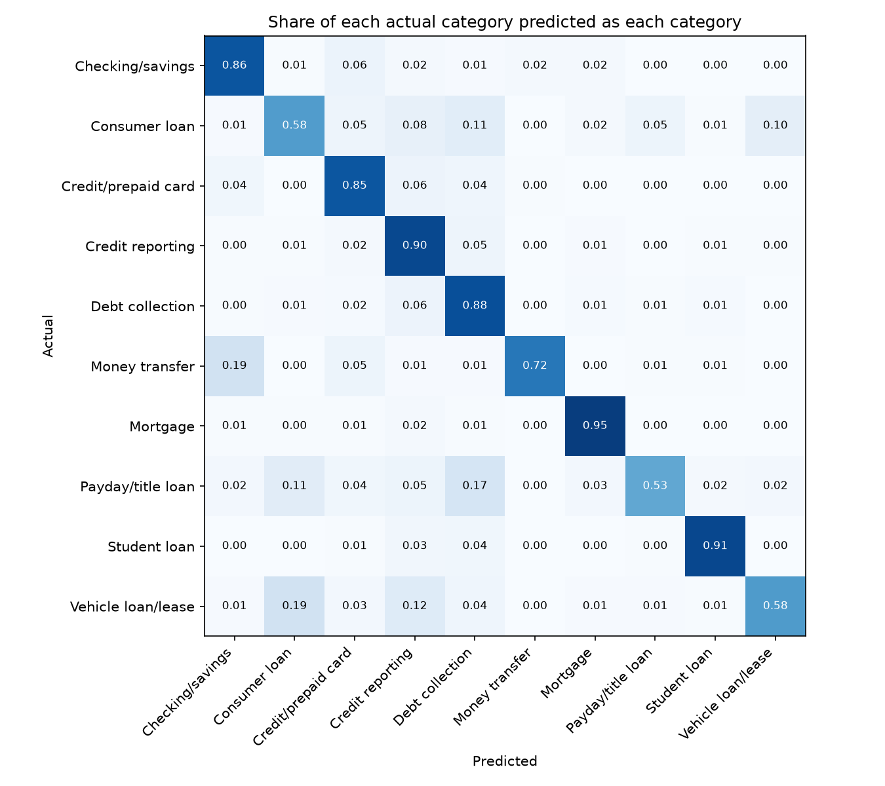
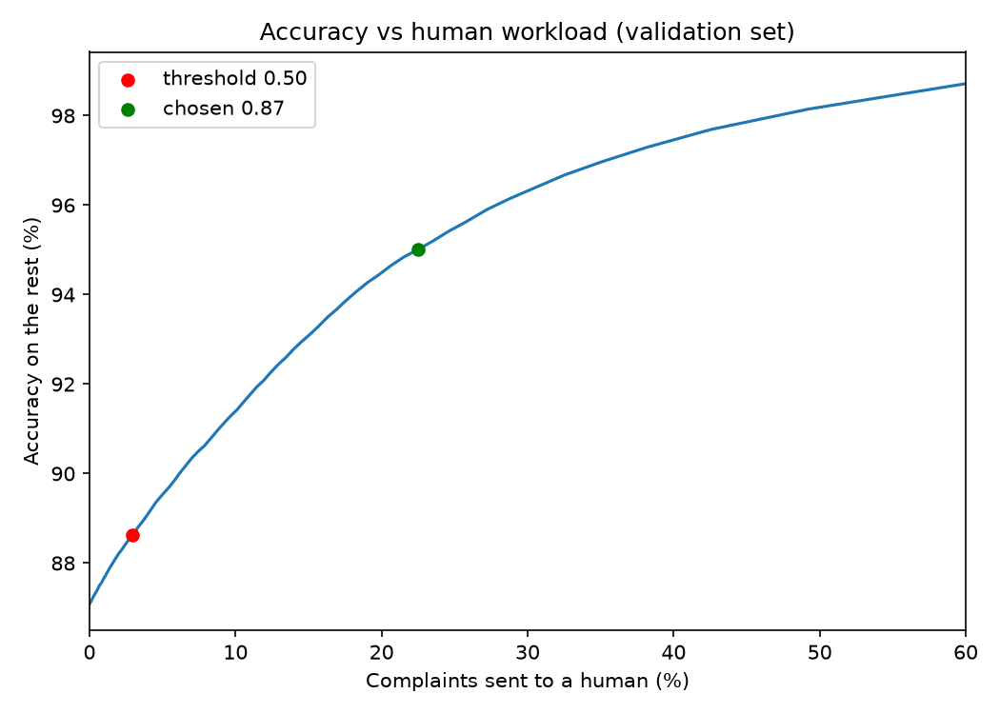

# Consumer Complaint Triage Classifier

Sorts consumer financial complaints into 10 categories with a fine-tuned DistilBERT, and sends the ones it is unsure about to a human instead of guessing.


[](https://huggingface.co/maryolarewaju/complaint-triage-distilbert)

<!-- Add after the Space is live:
[](SPACE_URL)
Add after GitHub Actions is green:

Add after the LICENSE file exists:

-->

<!-- Add after the Space is live:
**Live demo:** SPACE_URL (no login or API key needed)


-->

## The problem

A bank gets thousands of complaints a day, and each one has to reach the right team. Sorting them by hand is slow, and a complaint that reaches the wrong team waits. This project reads the complaint text, picks one of 10 product categories, and gives a confidence score. When the confidence is low, it says `needs_human_review` and does not force an answer.

## What it does

- Reads a complaint and returns a category and a confidence score.
- Flags low-confidence complaints for a person. The cutoff is 0.87, picked from data (see "Choosing the cutoff").
- Rejects empty, too-short (under 5 words) and non-text input with a clear message, not a crash.
- Beats a TF-IDF and Logistic Regression baseline on every overall measure I tracked.

Example, from `src/predict.py`:

```
"My mortgage servicer applied my payment to the wrong month and now shows me as 60 days late."
{'prediction': 'needs_human_review', 'top_guess': 'Mortgage', 'confidence': 0.658}

"no"
{'prediction': 'invalid_input', 'error': 'Input too short to classify reliably (minimum 5 words).'}
```

<!-- Add one confident example, using the real output from your own run:
"<a clear complaint>"
{'prediction': '...', 'confidence': ...}
-->

## Data

380,371 real complaints from the CFPB Consumer Complaint Database, 2015 to 2019, 10 categories, split 70/15/15 (266,259 train, 57,056 validation, 57,056 test) with stratification so every split keeps the same category mix.

CFPB stopped publishing complaint narratives in its public database in August 2026, so the live source no longer has the text this project needs. I used a public mirror of the older data. <!-- TODO: add the CFPB announcement link here, and the Kaggle mirror link (Consumer Complaint Database by selener) -->

The categories are very uneven. The biggest has about 124,000 complaints and the smallest about 5,700 in the full cleaned set.

## Results

All numbers are on the held-out test set.

| Model | Weighted F1 | Macro F1 |
| --- | --- | --- |
| TF-IDF + Logistic Regression (class-weighted) | 0.82 | 0.72 |
| Fine-tuned DistilBERT, all 57,056 test complaints | 0.872 | 0.787 |
| Fine-tuned DistilBERT, 53,866 complaints not seen in training | 0.867 | 0.786 |

Weighted F1 favors big categories, so I also report macro F1, which counts every category equally. The last row removes 3,190 test complaints (5.6%) whose text also appears in the training set. Those were scored in the second row too, so the third row is the number I quote.

F1 per category, DistilBERT, all test complaints:

| Category | F1 | Test complaints |
| --- | --- | --- |
| Mortgage | 0.942 | 7,934 |
| Credit reporting | 0.905 | 18,362 |
| Student loan | 0.899 | 3,260 |
| Debt collection | 0.873 | 12,880 |
| Checking or savings | 0.851 | 4,151 |
| Credit or prepaid card | 0.844 | 6,231 |
| Money transfer | 0.787 | 1,043 |
| Vehicle loan or lease | 0.595 | 860 |
| Payday, title or personal loan | 0.592 | 921 |
| Consumer loan | 0.585 | 1,414 |



### Choosing the cutoff

I first used 0.5 as the cutoff, with no evidence behind it. On validation data it sent only 2.9% of complaints to a person and lifted accuracy from 87.1% to 88.6%. So I swept every cutoff from 0 to 1 and plotted accuracy against how many complaints go to a person.

| Cutoff | Sent to a person | Accuracy on the rest | Data |
| --- | --- | --- | --- |
| 0.50 (my first guess) | 2.9% | 88.6% | validation |
| 0.87 (chosen) | 22.5% | 95.0% | validation |
| 0.87 | 22.6% | 95.1% | test |

I chose 0.87 on validation, then checked it once on test. The two agreed. The 95% target is a business choice: a team with fewer reviewers could pick a lower target, and the chart shows what that costs.



## How it works

1. Clean the text and merge category names that CFPB renamed in 2017.
2. Drop categories under 1,000 complaints and complaints under 10 words.
3. Fine-tune `distilbert-base-uncased` for 3 epochs on a free Kaggle GPU. I kept the epoch 2 model, not epoch 3 (see below).
4. At prediction time, validate the input, run the model, turn scores into probabilities, and compare the top probability to the cutoff.

The model is on Hugging Face: [maryolarewaju/complaint-triage-distilbert](https://huggingface.co/maryolarewaju/complaint-triage-distilbert).

## Choices and bugs

**Epoch 2, not epoch 3.** Validation F1 was 0.8700 at epoch 2 and 0.8707 at epoch 3, a gain too small to matter. Validation loss rose from 0.808 to 0.903 while training loss kept falling, which is overfitting. I kept epoch 2.

**A bug with no error message.** My first test-set run printed a full report with no errors, and it predicted "Debt collection" for all 57,056 complaints. I traced it back one step at a time: the model file was the right size, its scores looked healthy, and the tokenized input was just `[2, 1, 1, 1, ...]`. The checkpoint had no tokenizer files, and loading the tokenizer from it quietly produced an empty vocabulary. I loaded the tokenizer from `distilbert-base-uncased` instead and the real result came back.

**Two names for one thing.** CFPB renamed its product list in 2017, so the same category appeared under two names. I merged them before training.

## Limitations

- **Three weak categories.** Vehicle loan, Payday/title loan and Consumer loan sit near 0.59 F1.
- **Part of that weakness is the labels.** "Consumer loan" ends on 2017-04-21 and "Vehicle loan or lease" begins on 2017-04-24. By sub-product, 64% of the old Consumer loan complaints are vehicle loans or leases, so the model has to tell apart two names for the same kind of complaint. Fixing it means relabeling and retraining.
- **The model leans toward big categories.** I did not weight classes when fine-tuning the transformer, so most of its mistakes send small categories to Debt collection or Credit reporting. The baseline was class-weighted. Weighting the transformer is the next thing I would try.
- **Confidence is not a guarantee.** In 10 mistakes I read by hand, the lowest confidence was 0.51. Several complaints describe a debt collector and never mention the original loan, and a person would also file them under debt collection.
- **Long complaints are cut off.** In a sample of 1,000, about 11.6% were longer than the model's 512-token limit.
- **Old data.** Complaints are from 2015 to 2019, and the text has masked names and numbers ("XXXX").
- **The 0.87 cutoff** suits a 95% accuracy target on this data. A different target or different data needs a new sweep.
- **Not for real compliance decisions.**

## Run it yourself

```
git clone https://github.com/olarewajumary/complaint-triage-classifier.git
cd complaint-triage-classifier
python -m venv venv
venv\Scripts\activate
pip install -r requirements.txt
hf download maryolarewaju/complaint-triage-distilbert --local-dir models/final_model
python src/predict.py
```

To rebuild the data and the numbers, put the Kaggle mirror CSV at `data/raw/consumer_complaints_kaggle.csv`, then:

```
python src/download_data.py
python src/split_data.py
python src/train_baseline.py
```

The saved test-set scores used for the evaluation were made on a free Kaggle GPU. Put them in `data/processed/` as `test_probs.npy` and `val_probs.npy`, then:

```
python src/evaluate.py
python src/confusion_matrix_plot.py
python src/error_analysis.py
python src/tune_threshold.py
```

<!-- Add after train.py exists: a "Training" section with the command, seeds and package versions. -->

## Built with

Python, pandas, scikit-learn (TF-IDF and Logistic Regression), PyTorch, Hugging Face Transformers (DistilBERT), Hugging Face Hub, matplotlib, Kaggle free GPU.

The git history shows the order the work happened in.