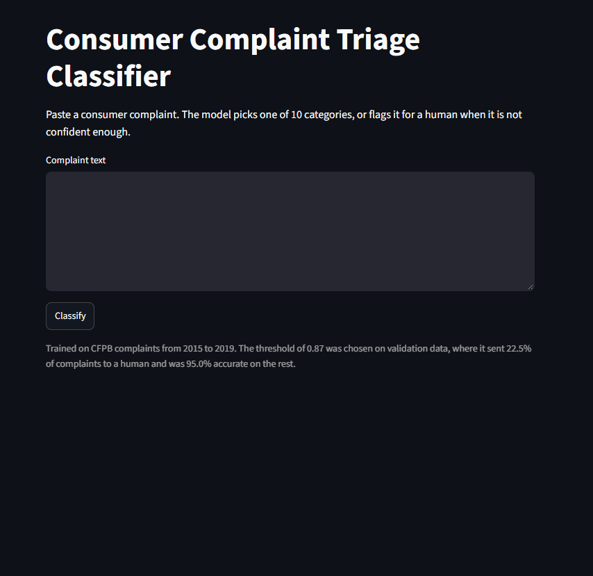
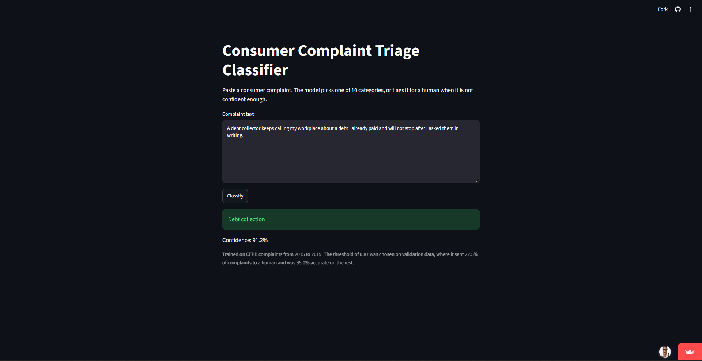
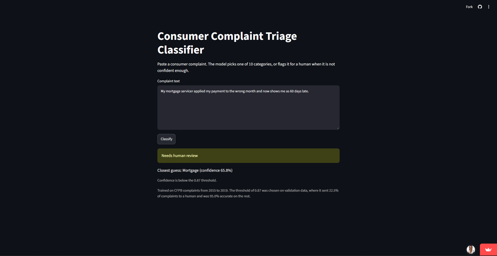
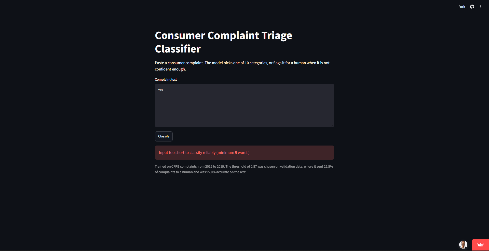
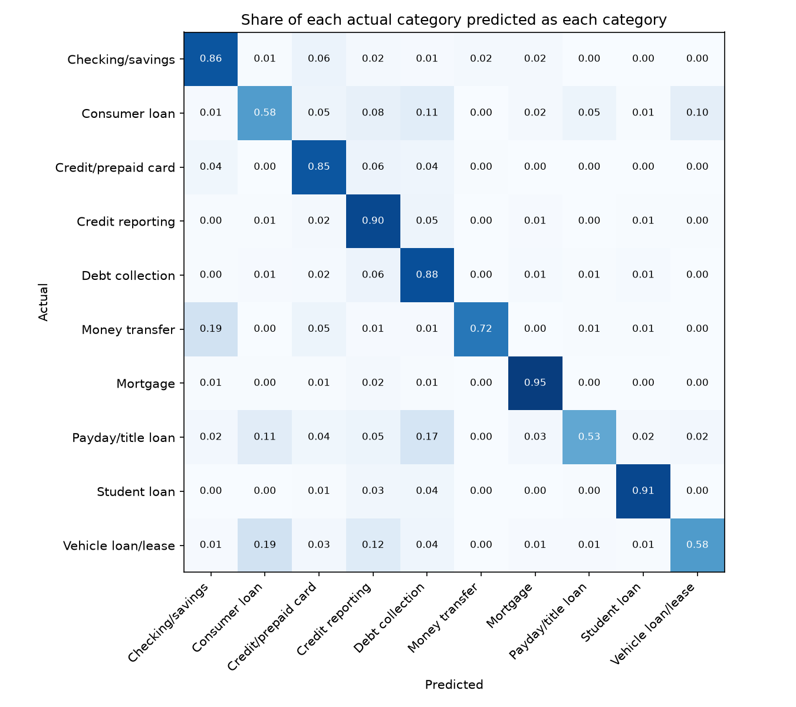
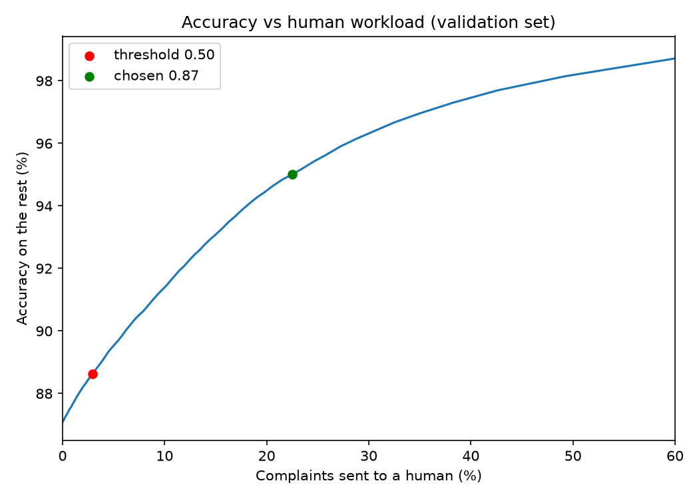

# Consumer Complaint Triage Classifier

Weighted F1 is 0.867 on the 53,866 test complaints that were not in the training data. With the 0.87 cutoff, the model answers 77.4% of the full test set on its own at 95.1% accuracy and sends 22.6% to a person.

Sorts consumer financial complaints into 10 categories with a fine-tuned DistilBERT, and sends the ones it is unsure about to a human instead of guessing.


[](https://huggingface.co/maryolarewaju/complaint-triage-distilbert)

[](https://complaint-triage.streamlit.app/)
[](https://github.com/olarewajumary/complaint-triage-classifier/actions/workflows/ci.yml)
[](LICENSE)

## Live demo

Try it here: [complaint-triage.streamlit.app](https://complaint-triage.streamlit.app/)



The app loads the model from the Hugging Face Hub. Free Streamlit apps can go to sleep when nobody is using them, so the first visit can be slow.

| Confident prediction | Sent to a human | Invalid input |
| --- | --- | --- |
|  |  |  |

## The problem

A company that receives consumer financial complaints has to route each one to the right team.

## What it does

- Reads a complaint and returns a category and a confidence score.
- Flags low-confidence complaints for a person. The cutoff is 0.87, picked from data (see "Choosing the cutoff").
- Rejects empty, too-short (under 5 words) and non-text input with a clear message, not a crash.

Example, from `src/predict.py`:

```
"A debt collector keeps calling my workplace about a debt I already paid and will not stop after I asked them in writing."
{'prediction': 'Debt collection', 'confidence': 0.912}

"My mortgage servicer applied my payment to the wrong month and now shows me as 60 days late."
{'prediction': 'needs_human_review', 'top_guess': 'Mortgage', 'confidence': 0.658}

"yes"
{'prediction': 'invalid_input', 'error': 'Input too short to classify reliably (minimum 5 words).'}
```

## Data

380,371 real complaints from the CFPB Consumer Complaint Database, 2015 to 2019, 10 categories, split 70/15/15 (266,259 train, 57,056 validation, 57,056 test) with stratification so every split keeps the same category mix.

CFPB stopped publishing complaint narratives in its public database in August 2026 ([CFPB announcement](https://www.consumerfinance.gov/about-us/newsroom/the-cfpb-to-cease-discretionary-publication-of-complaint-narratives-and-visualizations/)), so the live source no longer has the text this project needs. I used a public mirror of the older data: the [Consumer Complaint Database by selener on Kaggle](https://www.kaggle.com/datasets/selener/consumer-complaint-database).

The categories are very uneven. The biggest has about 122,000 complaints and the smallest about 5,700 in the full cleaned set.

## Results

All numbers are on the held-out test set.

| Model | Weighted F1 | Macro F1 |
| --- | --- | --- |
| TF-IDF + Logistic Regression (class-weighted) | 0.82 | 0.72 |
| Fine-tuned DistilBERT, all 57,056 test complaints | 0.872 | 0.787 |
| Fine-tuned DistilBERT, 53,866 complaints not seen in training | 0.867 | 0.786 |

Weighted F1 favors big categories, so I also report macro F1, which counts every category equally. The last row removes 3,190 test complaints (5.6%) whose text also appears in the training set. Those were scored in the second row too, so the third row is the number I quote.

F1 per category, DistilBERT, all test complaints:

| Category | F1 | Test complaints |
| --- | --- | --- |
| Mortgage | 0.942 | 7,934 |
| Credit reporting | 0.905 | 18,362 |
| Student loan | 0.899 | 3,260 |
| Debt collection | 0.873 | 12,880 |
| Checking or savings | 0.851 | 4,151 |
| Credit or prepaid card | 0.844 | 6,231 |
| Money transfer | 0.787 | 1,043 |
| Vehicle loan or lease | 0.595 | 860 |
| Payday, title or personal loan | 0.592 | 921 |
| Consumer loan | 0.585 | 1,414 |



### Choosing the cutoff

I first used 0.5 as the cutoff, with no evidence behind it. On validation data it sent only 2.9% of complaints to a person and lifted accuracy from 87.1% to 88.6%. So I swept every cutoff from 0 to 1 and plotted accuracy against how many complaints go to a person.

| Cutoff | Sent to a person | Accuracy on the rest | Data |
| --- | --- | --- | --- |
| 0.50 (my first guess) | 2.9% | 88.6% | validation |
| 0.87 (chosen) | 22.5% | 95.0% | validation |
| 0.87 | 22.6% | 95.1% | test |

I chose 0.87 on validation, then checked it once on test. The two agreed. The 95% target is a business choice: a team with fewer reviewers could pick a lower target, and the chart shows what that costs.



## How it works

1. Clean the text and merge category names that CFPB renamed in 2017.
2. Drop categories under 1,000 complaints and complaints under 10 words.
3. Fine-tune `distilbert-base-uncased` on a Kaggle GPU in two stages. Stage 1 is one epoch from the base model. Stage 2 continues from that checkpoint for 3 more epochs. I kept the epoch 2 checkpoint of stage 2, not epoch 3 (see below), so the published model has seen 3 epochs in total.
4. At prediction time, validate the input, run the model, turn scores into probabilities, and compare the top probability to the cutoff.

The model is on Hugging Face: [maryolarewaju/complaint-triage-distilbert](https://huggingface.co/maryolarewaju/complaint-triage-distilbert).

## Choices and bugs

**Epoch 2, not epoch 3.** In the second training stage, validation F1 was 0.8700 at epoch 2 and 0.8707 at epoch 3. I treated that 0.0007 gap as too small to matter, which is a judgment call. Validation loss rose from 0.808 to 0.903 while training loss fell from 0.584 to 0.432, which is a sign of overfitting. The trainer was set to keep the best F1 checkpoint, which would have been epoch 3, so I picked the epoch 2 checkpoint by hand.

**A bug with no error message.** My first test-set run printed a full report with no errors, and it predicted "Debt collection" for all 57,056 complaints. I traced it back one step at a time: the model file was the right size, its scores looked healthy, and the tokenized input was just `[2, 1, 1, 1, ...]`. The checkpoint had no tokenizer files, and loading the tokenizer from it quietly produced an empty vocabulary. I loaded the tokenizer from `distilbert-base-uncased` instead and the real result came back.

## Limitations

- **Three weak categories.** Vehicle loan, Payday/title loan and Consumer loan sit near 0.59 F1.
- **Part of that weakness is the labels.** "Consumer loan" ends on 2017-04-21 and "Vehicle loan or lease" begins on 2017-04-24. By sub-product, 64% of the old Consumer loan complaints are vehicle loans or leases, so the model has to tell apart two names for the same kind of complaint. Fixing it means relabeling and retraining.
- **The model leans toward big categories.** I did not weight classes when fine-tuning the transformer, so most of its mistakes send small categories to Debt collection or Credit reporting. The baseline was class-weighted. Weighting the transformer is the next thing I would try.
- **Confidence is not a guarantee.** In 10 mistakes I read by hand, the lowest confidence was 0.51. Several complaints describe a debt collector and never mention the original loan, and I judged that a person might also file them under debt collection.
- **Long complaints are cut off.** 10.9% of the test complaints (6,239 of 57,056) are longer than the model's 512-token limit, and the text past the limit is not read. `src/check_token_lengths.py` prints this count.
- **Old data.** Complaints are from 2015 to 2019, and the text has masked names and numbers ("XXXX").
- **The 0.87 cutoff** suits a 95% accuracy target on this data. A different target or different data needs a new sweep.
- **Not for real compliance decisions.**

## Run it yourself

```
git clone https://github.com/olarewajumary/complaint-triage-classifier.git
cd complaint-triage-classifier
python -m venv venv
venv\Scripts\activate
pip install -r requirements.txt
hf download maryolarewaju/complaint-triage-distilbert --local-dir models/final_model
python src/predict.py
```

To rebuild the data and the numbers, install the training requirements (`pip install -r requirements-train.txt`), put the Kaggle mirror CSV at `data/raw/consumer_complaints_kaggle.csv`, then:

```
python src/download_data.py
python src/split_data.py
python src/train_baseline.py
```

The test-set and validation scores come from one inference pass on a Kaggle GPU. Put the scores in `data/processed/` as `test_probs.npy` and `val_probs.npy`, then:

```
python src/evaluate.py
python src/confusion_matrix_plot.py
python src/error_analysis.py
python src/tune_threshold.py
```

## Training

`src/train.py` is the stage 2 training code from my Kaggle notebooks. It continues from a checkpoint made by a 1-epoch stage 1 run that is not in this repo, so `--checkpoint` is required. Install the training requirements first: `pip install -r requirements-train.txt`.

```
python src/train.py --checkpoint <folder with the stage 1 checkpoint>
```

Settings, read from the `training_args.bin` saved by the real run: learning rate 5e-5, weight decay 0, no warmup, linear schedule, fp16, seed 42, 512 tokens with padding to max length, 16 per device, 3 epochs. Stage 2 took 6h27m on a Kaggle GPU session.

What I did not record or confirm:

- **Package versions.** I installed with unpinned `pip`, so the training versions are unknown. `requirements-train.txt` lists the versions I ran locally, not the ones used for training.
- **The accelerator.** The steps per epoch and the throughput suggest an effective batch of about 32, which I think means two GPUs at 16 each. That is an inference, and I never confirmed the GPU type.
- **Python version.** It was 3.13, read from a path in a warning message.
- **The seed.** 42 is the library default and the notebook did not set it. `train.py` sets it explicitly.
- **Stage 1 code.** I do not have the stage 1 notebook, only its saved settings.

I tested `train.py` end to end on a small sample on my laptop CPU (8 steps) to check that it runs:

```
python src/train.py --checkpoint distilbert-base-uncased --sample-rows 32 --epochs 1 --batch-size 4
```

The score from that run is meaningless at 32 rows. The script ends on the best-F1 epoch, which was epoch 3 in my real run. The published model is the epoch 2 checkpoint I picked by hand (see "Choices and bugs").

## API

`src/api.py` serves the classifier over HTTP with FastAPI. The model loads once when the server starts.

```
pip install -r requirements-api.txt
python -m uvicorn src.api:app --port 8000
```

- `GET /health` returns `{"status": "ok"}`.
- `POST /predict` takes `{"text": "..."}` and returns the same fields as `predict()`: `prediction`, `confidence`, and `top_guess` when the answer is `needs_human_review`.
- Text that is empty, too short or not a string gets HTTP 422 with the reason.
- `/docs` shows the interactive docs page.

I tested these four cases by hand: health, a real prediction, text that is too short, and a number instead of text. I have not load-tested it.

## Docker

```
docker build -t complaint-triage-api .
docker run -d --name triage-api -p 8000:8000 complaint-triage-api
```

The build copies `models/final_model` into the image, so run the `hf download` command from "Run it yourself" first. I baked the model in so the container needs no download when it starts, and `HF_HUB_OFFLINE=1` enforces that. The cost is a bigger image and a rebuild when the model changes.

What I checked on the image (Python 3.14 slim base, `torch 2.14.0+cpu`):

- Docker reports a size of 2.24 GB on disk.
- The model file inside has the same SHA-256 as the one on Hugging Face (starts `13030093e3d2`).
- It runs as a non-root user, and the container reports healthy.
- The model loads with the network switched off.
- The mortgage example gives confidence 0.658 in the container, the same as on my laptop.

I built and ran it with Docker Desktop on Windows. I have not tested other hosts or pushed the image to a registry.

## Tests and CI

```
pip install -r requirements-test.txt
python -m pytest tests
ruff check app.py src tests
```

There are 28 tests: input validation, data cleaning, the duplicate flag and the API. The API tests use a fake `predict` and a fake model loader, so no model is loaded. GitHub Actions runs the lint and the tests on pushes to `main` and on pull requests.

To check the gate, I opened a pull request with a deliberately broken error message. The checks failed, and I closed it without merging. Checks do not block merging yet, because I have not set a branch protection rule.

## Built with

Python, PyTorch, Hugging Face Transformers (DistilBERT), scikit-learn (baseline), Streamlit. Exact versions are in `requirements.txt` and `requirements-train.txt`.